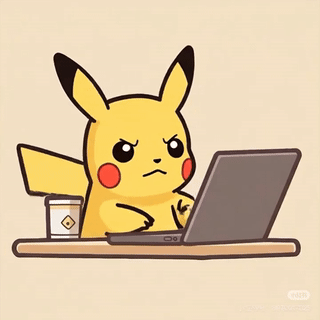

 

<samp>WEB DEVELOPER &nbsp; / &nbsp; PLATFORM ENGINEER &nbsp; / &nbsp; UAM · ADS</samp>

  

  

<samp>Writing code &amp; romanticizing the little things. Taylor Swift on repeat, a book nearby, and cats always welcome.</samp>

  

✧ &nbsp; **the things I build with** &nbsp; ✧

  

  

  

<samp>☾ &nbsp; cats, books, photography &amp; a little bit of magic &nbsp; ☆</samp>

